# ⚡ Awesome Distributed Database & Embedded Storage 🚀

  <strong>A Curated Directory of Next-Generation Distributed SQL/NoSQL Engines, Cloud DBaaS, and Ultra-High-Performance Embedded Storage Architectures</strong>

  
  
  
  
  
  

---

## 📌 Table of Contents

- [🌟 Overview](#-overview)
- [📊 Sector Overview & Market Dynamics](#-sector-overview--market-dynamics)
- [☁️ SaaS & Managed Cloud Database Platforms](#️-saas--managed-cloud-database-platforms)
- [💻 Open-Source Storage Engines & Distributed Databases](#-open-source-storage-engines--distributed-databases)
  - [🏆 Tier 1: Ecosystem Titans (50K+ Stars)](#-tier-1-ecosystem-titans-50k-stars)
  - [🥇 Tier 2: Heavyweight Data Engines (20K–50K Stars)](#-tier-2-heavyweight-data-engines-20k50k-stars)
  - [🥈 Tier 3: Production Workhorses & Distributed Kernels (10K–20K Stars)](#-tier-3-production-workhorses--distributed-kernels-10k20k-stars)
  - [🥉 Tier 4: Embedded Systems, Storage Engines & Emerging Innovations (<10K Stars)](#-tier-4-embedded-systems-storage-engines--emerging-innovations-10k-stars)
- [📈 Star History](#-star-history)
- [🤝 How to Contribute](#-how-to-contribute)
- [💖 Support & Sponsorship](#-support--sponsorship)
- [📜 Disclaimer](#-disclaimer)

---

## 🌟 Overview

Welcome to the **Awesome Distributed Database & Embedded Storage** knowledge repository! Modern data-intensive applications require architectures that balance zero-downtime distributed consensus across planetary clouds with ultra-low latency, in-process, zero-copy embedded persistence engines.

This guide is designed for **backend software engineers**, **distributed systems architects**, **cloud infrastructure builders**, and **database kernel developers** seeking an authoritative index of:
- **Cloud DBaaS & Serverless Engines**: Horizontally auto-scaling SQL/NoSQL transactional platforms with compute-storage decoupling.
- **Embedded Key-Value & Relational Storage**: In-process B+Tree and LSM-tree persistence engines designed for microsecond read/write paths.
- **Distributed Consensus Layers**: Raft, Paxos, and distributed transaction protocols powering fault-tolerant multi-master topologies.

---

## 📊 Sector Overview & Market Dynamics

The global distributed database and cloud database-as-a-service (DBaaS) market is estimated at **$11.8 billion to $14.7 billion in 2026**, expanding at an aggressive Compound Annual Growth Rate (CAGR) of **16.5% to 19.2%** as enterprise workloads migrate to multi-region architectures and agentic AI pipelines.

The sector exhibits **moderate concentration with a bifurcated competitive structure**:
- **Enterprise & Hyperscale Layer (Concentrated / Oligopoly)**: Hyperscalers (AWS Aurora, Google Cloud Spanner, Microsoft Azure) and top-tier multi-cloud unicorns capture the lion's share of high-throughput transactional enterprise spend through managed cloud infrastructure.
- **Developer, Edge & Open-Source Kernel Layer (Highly Fragmented)**: The embedded and specialized storage engine space remains intensely fragmented. Innovative architectures (vector-integrated HTAP engines, Rust-based LSM stores, SQLite-compatible edge databases, and serverless scale-to-zero Postgres forks) vigorously compete to power the next generation of local-first software and AI inference pipelines.

---

## ☁️ SaaS & Managed Cloud Database Platforms

The table below lists the prominent managed and serverless database platforms, sorted in descending order by **Company Size / Market Valuation / Annual Revenue**:

| 🏢 Product | 📝 Description | 💰 Company Size (Valuation / Revenue) | 🏷️ Pricing | 🎁 Free Tier / Trial Limits |
| :--- | :--- | :--- | :--- | :--- |
| **[Amazon Aurora Serverless](https://amazon.com)** | On-demand, auto-scaling cloud-native relational database engine compatible with MySQL and PostgreSQL. | **~$2.2 Trillion (Market Cap)** / AWS ~$105B+ ARR | Starting at **$0.12/ACU-hour** (scales in 0.5 ACU increments; ~$43.20/month at continuous min. 0.5 ACU floor) | **AWS Free Tier credits**: $100–$200 sign-up promotional credits valid for 12 months, with free tier configurations allowing up to 4 ACUs and 1 GiB storage. |
| **[Google Cloud Spanner](https://google.com)** | Globally distributed, strongly consistent relational database service utilizing TrueTime atomic clocks for external consistency. | **~$2.1 Trillion (Market Cap)** / Google Cloud ~$40B+ ARR | Starting at **$0.09 per 100 processing units/hour** (~$65/month baseline compute for 100 PUs; $0.90/node-hour) | **90-day free trial instance** with up to 10 GiB database storage and 5 databases (plus $300 GCP sign-up trial credits). |
| **[Supabase](https://supabase.com)** | Managed open-source Firebase alternative built on PostgreSQL with authentication, instant APIs, storage, and edge functions. | **$10.5 Billion Valuation** (Series F) | Starting at **$25/month** per organization (Pro tier, includes $10 compute credit) | **Free forever plan**: up to 2 active projects, 500 MB database size, 0.5 GB RAM, 1 GB file storage, 50,000 MAUs, 5 GB egress/month, and 500,000 edge function invocations (auto-pauses after 7 days inactivity). |
| **[CockroachDB Dedicated](https://cockroachlabs.com)** | Fully managed, single-tenant distributed SQL database engineered for global scale, survivability, and strong ACID consistency. | **$5.0 Billion Valuation** / ~$140M+ ARR | Starting at **$0.60/hour** (Advanced dedicated tier, min. 4 vCPUs) | **$400 free trial credits** for new cloud organizations (or free-forever Basic serverless tier up to 50M RUs & 10 GiB storage/month). |
| **[TiDB Cloud](https://pingcap.com)** | Fully managed cloud-native HTAP (Hybrid Transactional and Analytical Processing) database service compatible with MySQL. | **$3.0 Billion Valuation** (Series D) | Starting at **$0.22/hour** (Dedicated tier) / **$400/month** (Essential tier) | **Free forever plan**: up to 5 instances, 250M Request Units (RUs)/month, 25 GiB row storage, and 25 GiB columnar storage. |
| **[YugabyteDB Managed](https://yugabyte.com)** | Fully managed Distributed SQL-as-a-Service built on PostgreSQL-compatible architecture for cloud-native transactional workloads. | **$1.3 Billion Valuation** (Series C) | Starting at **$0.25/vCPU-hour** (Standard/Professional production tier) | **Free forever Sandbox tier**: 1 cluster, 2 vCPUs, 4 GB RAM, 10 GB storage, and 25 concurrent connections (or 30-day dedicated trial with trial credits). |
| **[Neon Serverless Postgres](https://neon.tech)** | Managed serverless PostgreSQL platform separating storage and compute with instant database branching and scale-to-zero. | **$1.0 Billion (Acquired by Databricks)** | Starting at **$0.106/CU-hour** (~$15/month typical spend on Launch tier; 1 CU = 1 vCPU + 4 GB RAM) | **Free forever plan**: up to 100 projects, 100 CU-hours/project/month, 1 GB storage/project (up to 20 GB account total), 10 branches/project, and 5 GB egress/month. |
| **[SingleStore Helios](https://singlestore.com)** | Managed cloud-native distributed SQL database built for ultra-fast real-time analytics and transactional processing. | **$500 Million Valuation** / ~$123M ARR | Starting at **$0.99/hour** (Standard S-00 instance: 2 vCPUs, 16 GB RAM) | **Free forever shared tier**: 1 GB compressed storage (~4 GB uncompressed) with full HTAP & vector engine features (plus $500 free trial credits for Standard clusters). |
| **[PlanetScale](https://planetscale.com)** | MySQL-compatible serverless database platform powered by Vitess with non-blocking schema changes and horizontal sharding. | **~$350 Million Valuation** | Starting at **$5/month** (single-node dev database) or **$15/month** (PS-5 3-node HA cluster) | **14-day free trial** with access to core platform features and development branches (no permanent free tier; requires paid plan starting at $5/mo). |
| **[FaunaDB (Fauna)](https://fauna.com)** | Globally distributed, serverless document-relational database offering strict serializability and native APIs. | **Acquired / Sunsetted** (Raised $150M+ historically) | Starting at **$25/month** (historical self-serve entry tier prior to cloud sunset) | **Free tier historical limit**: 5 databases, 1 GB storage, 100K Read Ops, 50K Write Ops, and 500K Compute Ops/month (cloud service sunsetted May 30, 2025; engine open-sourced). |

---

## 💻 Open-Source Storage Engines & Distributed Databases

Below is an expanded catalogue of open-source projects, storage kernels, distributed systems, and embedded engines. Each repository displays a social star badge linking directly to its GitHub Stargazers page, sorted strictly by **GitHub Star Count (descending)**.

### 🏆 Tier 1: Ecosystem Titans (50K+ Stars)

1. **[Supabase](https://github.com/supabase/supabase)**   
   The open-source PostgreSQL developer platform providing GoTrue authentication, PostgREST instant APIs, Realtime subscriptions, storage, and Studio UI.
2. **[etcd](https://github.com/etcd-io/etcd)**   
   Graduated CNCF distributed reliable key-value store implementing the Raft consensus algorithm, powering Kubernetes cluster metadata and distributed locking.

---

### 🥇 Tier 2: Heavyweight Data Engines (20K–50K Stars)

3. **[Milvus](https://github.com/milvus-io/milvus)**   
   Cloud-native, open-source distributed vector database built for massive-scale similarity search and AI vector embeddings.
4. **[DuckDB](https://github.com/duckdb/duckdb)**   
   In-process analytical (OLAP) SQL database management system optimized for vectorized query execution, Parquet querying, and Arrow memory buffers.
5. **[TiDB](https://github.com/pingcap/tidb)**   
   Open-source distributed HTAP database speaking MySQL wire protocol, separating compute from TiKV transactional storage with columnar TiFlash acceleration.
6. **[LevelDB](https://github.com/google/leveldb)**   
   Fast key-value embedded storage library developed by Google providing an ordered mapping from string keys to string values based on LSM-trees.
7. **[Qdrant](https://github.com/qdrant/qdrant)**   
   High-performance vector search engine and database written in Rust with dynamic payload filtering and distributed clustering.
8. **[SurrealDB](https://github.com/surrealdb/surrealdb)**   
   Scalable, distributed, multi-model document-graph database written in Rust supporting embedded and multi-tenant cloud clustering with SurrealQL.
9. **[CockroachDB](https://github.com/cockroachdb/cockroach)**   
   Cloud-native distributed SQL database utilizing Raft consensus and Pebble storage to deliver survivable, multi-region horizontal ACID transactions.
10. **[RocksDB](https://github.com/facebook/rocksdb)**   
    High-performance embedded persistent key-value store optimized by Meta for fast SSD flash and high concurrency via Log-Structured Merge-trees.
11. **[Dragonfly](https://github.com/dragonflydb/dragonfly)**   
    Next-generation in-memory data store fully compatible with Redis and Memcached APIs, utilizing multi-threaded shared-nothing architecture for 25x throughput.
12. **[Limbo](https://github.com/tursodatabase/limbo)**   
    Complete modern in-process SQL database engine written in pure Rust with async I/O (`io_uring`), designed as a contemporary alternative to SQLite.
13. **[Neon](https://github.com/neondatabase/neon)**   
    Open-source serverless PostgreSQL engine decoupling compute from a custom Rust-written Page Server and bottomless object storage with instant branching.
14. **[Vitess](https://github.com/vitessio/vitess)**   
    Database clustering system for horizontal sharding of MySQL at hyper-scale, originally engineered by YouTube and powering PlanetScale.
15. **[Apache ShardingSphere](https://github.com/apache/shardingsphere)**   
    Distributed database ecosystem and transparent middleware providing data sharding, distributed transactions, read-write splitting, and elastic governance.

---

### 🥈 Tier 3: Production Workhorses & Distributed Kernels (10K–20K Stars)

16. **[libSQL](https://github.com/tursodatabase/libsql)**   
    Open-contribution fork of SQLite designed by Turso for edge computing, embedded replication over HTTP/WebSockets, and WebAssembly compilation.
17. **[TiKV](https://github.com/tikv/tikv)**   
    Graduated CNCF distributed transactional key-value database written in Rust, delivering cross-datacenter ACID guarantees using Multi-Raft.
18. **[FoundationDB](https://github.com/apple/foundationdb)**   
    Apple's open-source distributed, transactional key-value store with deterministic simulation testing, handling mission-critical cloud infrastructure.
19. **[Apache Doris](https://github.com/apache/doris)**   
    High-performance, real-time analytical MPP database engine based on columnar storage, supporting sub-second OLAP queries across massive tables.
20. **[ScyllaDB](https://github.com/scylladb/scylladb)**   
    Ultra-low latency NoSQL database re-architected in C++ using the Seastar asynchronous reactor framework, compatible with Cassandra and DynamoDB.
21. **[BadgerDB](https://github.com/dgraph-io/badger)**   
    Pure Go embedded key-value store implementing WiscKey design with value log separation to minimize LSM-tree write amplification on NVMe SSDs.
22. **[Citus](https://github.com/citusdata/citus)**   
    Open-source PostgreSQL extension that shards tables across a multi-node cluster for horizontal scale-out and distributed query execution.
23. **[StarRocks](https://github.com/StarRocks/starrocks)**   
    Next-generation sub-second MPP analytics database utilizing vectorized execution, real-time materialized views, and cost-based query optimization.
24. **[FerretDB](https://github.com/FerretDB/FerretDB)**   
    Open-source MongoDB-compatible proxy engine translating wire protocol queries into native PostgreSQL or SQLite SQL queries.
25. **[YugabyteDB](https://github.com/yugabyte/yugabyte-db)**   
    Distributed SQL database built with DocDB storage (RocksDB-derived) and Raft consensus, exposing full PostgreSQL (YSQL) and Cassandra (YCQL) wire compatibility.

---

### 🥉 Tier 4: Embedded Systems, Storage Engines & Emerging Innovations (<10K Stars)

26. **[bbolt](https://github.com/etcd-io/bbolt)**   
    Fork of BoltDB maintained by the etcd team; provides a pure Go memory-mapped embedded key-value store based on copy-on-write B+trees.
27. **[sled](https://github.com/spacejam/sled)**   
    High-concurrency embedded key-value database written in Rust featuring lock-free Bw-tree indexing and flash-friendly log management.
28. **[Pebble](https://github.com/cockroachdb/pebble)**   
    RocksDB/LevelDB-inspired key-value storage engine engineered in pure Go by Cockroach Labs to power CockroachDB's low-level persistent storage layer.
29. **[MapDB](https://github.com/jankotek/mapdb)**   
    Embedded Java database engine and collection framework providing concurrent Maps, Sets, and Queues backed by off-heap memory or disk.
30. **[redb](https://github.com/cberner/redb)**   
    Simple, portable, ACID-compliant embedded key-value store in pure Rust inspired by LMDB, utilizing copy-on-write multi-version B-trees.
31. **[H2 Database](https://github.com/h2database/h2database)**   
    Fast open-source embedded and client/server Java relational database supporting in-memory and disk persistence with standard JDBC APIs.
32. **[OrioleDB](https://github.com/orioledb/orioledb)**   
    Modern cloud-native storage engine for PostgreSQL eliminating vacuum overhead and table bloat, with native row-level write scaling and S3 tiering.
33. **[Fjall](https://github.com/fjall-rs/fjall)**   
    Log-structured, embeddable key-value storage engine written in pure Rust featuring thread-safe multi-partition indexing and zero-copy reads.
34. **[Xodus-Nexus](https://github.com/domsvoboda/xodus-nexus)**   
    Modern application environment and high-performance transactional persistence runtime built upon JetBrains Xodus storage primitives.
35. **[JetBrains Xodus](https://github.com/JetBrains/xodus)**   
    Transactional, schema-less embedded database written in Java and Kotlin featuring log-structured storage, MVCC, and entity-store models.

---

## 📈 Star History

---

## 🤝 How to Contribute

Contributions are warmly welcomed! Help keep this ecosystem guide comprehensive, updated, and accurate:

1. 🍴 **Fork the repository** on GitHub.
2. 🌿 **Create a new branch**: `git checkout -b feature/add-new-storage-engine`.
3. 📝 **Add or update entries**: Ensure factual descriptions, verified links, specific starting prices, accurate free tier limits, and valid GitHub star badges.
4. 📬 **Submit a Pull Request** with a concise summary of the changes.

Please browse [Awesome-Awesome-Awesome](https://github.com/ishandutta2007/Awesome-Awesome-Awesome) for more curated lists!

---

## 💖 Support & Sponsorship

If you found this curated ecosystem map helpful for your work, research, or architecture decisions, consider showing your support:

- ⭐ **Star this repository** to help others discover it.
- 🍴 **Fork and share** with fellow developers and teams.
- ☕ **Buy me a coffee / Become a Sponsor**: Support continued open-source curation and development via the [GitHub Sponsors Dashboard](https://github.com/sponsors/ishandutta2007).

Your backing fuels ongoing benchmarks, architecture teardowns, and continuous ecosystem curation!

---

## 📜 Disclaimer

- This list is **community-curated** for architectural discovery and educational evaluation — inclusion does not constitute a formal commercial endorsement.
- Distributed database engines and persistent storage kernels require rigorous production benchmarking (e.g., Jepsen consistency verification, YCSB, Sysbench) to validate durability, partition-tolerance, and latency SLA guarantees for your specific workloads.
- Pricing, free allowances, and enterprise tier capabilities reflect current vendor policies and are subject to change.

---

  Built with ❤️ for backend engineers, database architects, systems programmers, and infrastructure teams worldwide.

